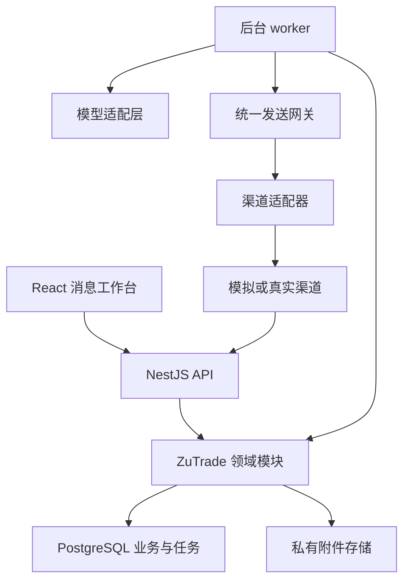
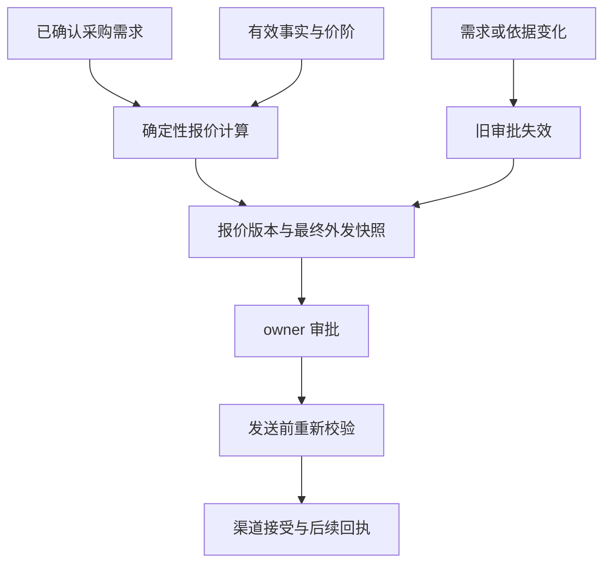
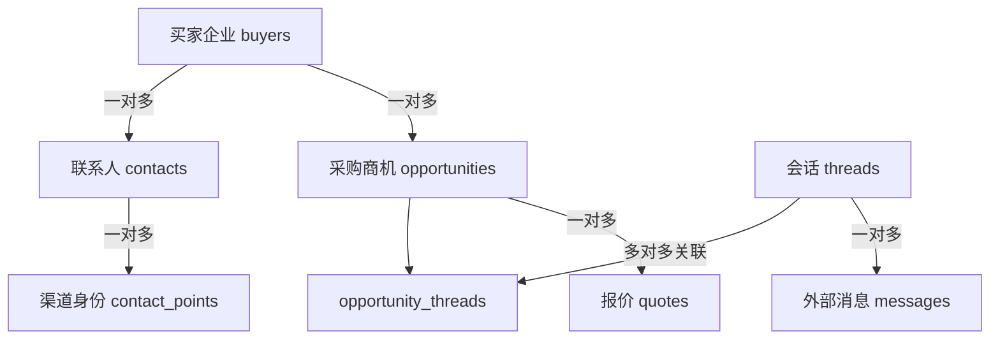
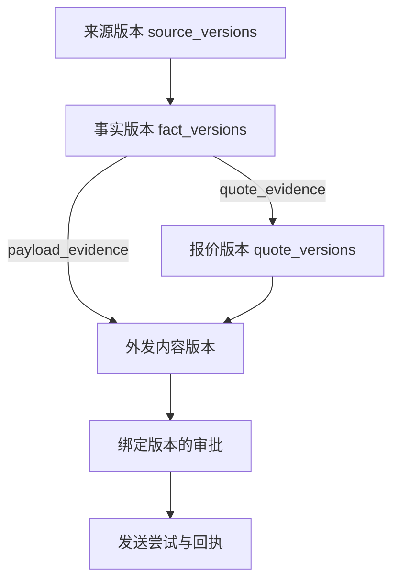

ZuTrade 第一版采用 TypeScript 模块化单体：React 消息工作台、NestJS API、独立 worker，共享 PostgreSQL 业务数据与领域规则。复用成熟的界面、认证、队列和模型调用组件；客户、工厂证据、报价版本、审批和发送授权由 ZuTrade 管理。这个选择服务于已经确认的目标：你与 1—4 位成员替工厂做销售，从模拟买家消息开始，完成可信报价与明确跟进。

技术决策日期为 2026 年 10 月 28 日。现有[产品与销售模型设计](https://chatgpt.com/space/page_52f5be6081048191aecb8ce7e7581da5)继续作为业务范围依据；这里确定工程边界、复用方案、数据模型及实施顺序。

# 1 架构决策

| 决策 | 第一版采用的方式 | 原因 |
| --- | --- | --- |
| 产品界面 | 微信式消息工作台，消息、找客户、产品、待办四个入口 | 日常工作从买家消息开始；审批和报价进入对话内的内部工作区 |
| 应用结构 | 一个 TypeScript monorepo；web、API、worker 三个运行入口 | 业务规则只维护一套，耗时任务独立运行，便于小团队迭代 |
| 数据底座 | PostgreSQL 18，业务 schema、认证 schema、队列 schema 分离 | 客户关系、报价、审批与任务需要事务和外键，暂不需要分布式数据库 |
| 后台执行 | pg-boss；业务状态持久化在自有表中 | 延迟跟进和重试不占据长时间运行的请求，进程重启后可恢复 |
| AI | AI SDK 加显式业务函数和结构化输出 | AI 提取需求、选资料、生成草稿；定价、审批、状态更新和发送由程序执行 |
| 外部消息 | MockAdapter 起步；随后逐个接正式渠道 | 模拟阶段即使用真实的数据结构、幂等机制与发送入口 |
| 复用方式 | 组件作为依赖；完整 CRM 和收件箱先作为架构参考 | 避免同时维护多个系统中的客户、会话、权限和审批状态 |
| 交易边界 | 工厂作为签约、收款和履约主体；ZuTrade 记录代理销售过程 | 首版止于报价与跟进，订单、付款、物流和佣金结算后续再建 |

“模块化单体”表示部署和数据库保持集中，但代码按职责分开。API 与 worker 共用领域代码，不通过相互调用 HTTP 来执行内部报价和审批逻辑。新功能必须通过模块公开的命令和查询进入，不能任意修改其他模块的数据表。

# 2 GitHub 复用评估

筛选依据是业务吻合度、真实可复用部分、许可证范围、维护信号与额外运行成本。仓库最近有更新仅说明仍在维护，不能代替安全审计、稳定性测试或功能验收。本次对重点候选检查了官方仓库、许可文件、架构文档及部分数据模型和执行路径；未将所有候选部署后进行性能比较。

## 2.1 完整产品与业务框架

| 项目 | 与 ZuTrade 接近的部分 | 许可与技术边界 | 采用决定 |
| --- | --- | --- | --- |
| [Chatwoot](https://github.com/chatwoot/chatwoot) | 多渠道共享收件箱、联系人、会话、分配、消息状态和 webhook | 社区核心 MIT，enterprise 目录另行许可；后端 Rails、前端 Vue，另有异步任务组件 | 最值得参考的消息模型。首版不部署；真实渠道复杂度上升时评估 Headless 接入 |
| [Twenty](https://github.com/twentyhq/twenty) | 公司、联系人、商机、活动和团队 CRM | 核心 AGPLv3，标记为 Enterprise 的代码另有许可；twenty-ui 等指定子包为 MIT，独立应用还有 Application Exception | 参考 CRM 对象边界；首版不 fork 整个 CRM。UI 先统一使用 shadcn，避免两套设计系统 |
| [Open Mercato](https://github.com/open-mercato/open-mercato) | TypeScript 业务模块、租户隔离、CRM、销售报价和工作流 | 核心 MIT，enterprise 包商业许可；Next.js、PostgreSQL、MikroORM，模块范围较广 | 最接近通用业务底座的候选；参考模块、报价快照和权限边界，首版不承接整个框架 |
| [Medusa](https://github.com/medusajs/medusa) | 领域模块、工作流、商品与定价扩展 | 核心 MIT，当前 LICENSE 对 Enterprise Edition 有明确例外；主要面向 commerce | 参考领域模块与外部服务适配方式；等交易订单成为产品核心时再评估 |
| [Dittofeed](https://github.com/dittofeed/dittofeed) | 事件触发触达、分群、消息旅程 | 公共代码 MIT；官方将多租户、embedding、white-label 放在单独许可的闭源版本 | 参考触达停止条件与事件模型；不引入第二个外发决策中心 |
| [EspoCRM](https://github.com/espocrm/espocrm) | 成熟 CRM 实体、活动、邮件和商机 | AGPLv3；PHP/JavaScript，与主方案技术栈不同 | 适合直接使用通用 CRM 的团队，当前仅参考实体与活动设计 |
| [FreeScout](https://github.com/freescout-help-desk/freescout) | 共享邮件收件箱和团队处理 | 核心及官方模块为 AGPLv3；PHP/Laravel，部分模块收费 | 邮箱业务显著复杂时作为备选，首版不引入 |

许可原文：[Chatwoot](https://github.com/chatwoot/chatwoot/blob/develop/LICENSE)、[Twenty](https://github.com/twentyhq/twenty/blob/main/LICENSE)、[Open Mercato 核心](https://github.com/open-mercato/open-mercato/blob/main/LICENSE)与[企业范围](https://github.com/open-mercato/open-mercato/blob/main/packages/enterprise/LICENSE.md)、[Medusa](https://github.com/medusajs/medusa/blob/develop/LICENSE)、[Dittofeed 版本说明](https://github.com/dittofeed/dittofeed/blob/main/README.md)、[EspoCRM](https://github.com/espocrm/espocrm/blob/master/LICENSE.txt)。AGPL 不等于禁止商业使用；直接修改、分发、网络服务与独立 API 集成的义务不同，应根据实际复用方式选择。

截至决策日，GitHub 正式 release 分别为 [Chatwoot v4.19.1，10 月 24 日](https://github.com/chatwoot/chatwoot/releases/tag/v4.19.1)、[Twenty v2.52.0，10 月 27 日](https://github.com/twentyhq/twenty/releases/tag/twenty/v2.52.0)、[EspoCRM 10.0.11，10 月 23 日](https://github.com/espocrm/espocrm/releases/tag/10.0.11)、[FreeScout 1.8.248，10 月 17 日](https://github.com/freescout-help-desk/freescout/releases/tag/1.8.248)。Dittofeed 最新正式版仍为 [v0.23.0，2025 年 12 月 1 日](https://github.com/dittofeed/dittofeed/releases/tag/v0.23.0)，预发布不能当作稳定版。EspoCRM 的报价和价格表属于 [Sales Pack 扩展](https://docs.espocrm.com/extensions/sales-pack/overview/)；FreeScout 的模块许可范围见[官方说明](https://github.com/freescout-help-desk/freescout/wiki/FreeScout-Modules)。

Open Mercato 的销售模型有客户、地址、费用等快照字段，其工作流模型有版本化定义和执行实例，值得参考；但 ZuTrade 仍需要自行实现报价证据链、最终外发审批和渠道资格检查。[销售模型](https://github.com/open-mercato/open-mercato/blob/main/packages/core/src/modules/sales/data/entities.ts)及[工作流模型](https://github.com/open-mercato/open-mercato/blob/main/packages/core/src/modules/workflows/data/entities.ts)能帮助研发理解这一分界。

Chatwoot 以后可以承担渠道适配，但 ZuTrade 继续作为业务事实源。接入时不开放能够绕过发送网关的原生 composer、发送 API 凭据、营销活动或自动回复。会话分配、审批和报价只有一套主状态，外部系统只保存对应渠道 ID 与运输记录。是否接入取决于邮件线程、附件、账号路由和渠道数量带来的真实复杂度，不按一个固定渠道数量机械决定。

## 2.2 队列 工作流与 AI 框架

| 项目 | 核查结论 | 第一版决定 |
| --- | --- | --- |
| [pg-boss](https://github.com/timgit/pg-boss) | MIT；PostgreSQL 队列；官方提供 Drizzle 同事务适配，支持延迟、重试和取消 | 直接使用。开发基线可锁 12.38.0，升级时审查迁移 |
| [BullMQ](https://github.com/taskforcesh/bullmq) | MIT；v6 已提供 PostgreSQL 后端，Redis 仍为默认实现 | 可行备选；选 pg-boss 的依据是当前事务集成更直接，不是 BullMQ 不能使用 PostgreSQL |
| [Trigger.dev](https://github.com/triggerdotdev/trigger.dev) | Apache-2.0；支持持久任务与人工等待；自托管和 Cloud 的能力、运行组件不同 | 有明确托管执行需求时评估；首版不自托管一整套执行平台 |
| [Inngest](https://github.com/inngest/inngest) | SDK Apache-2.0；server/CLI 为 SSPL，代码公布满三年后追加 Apache-2.0 | 技术上适合事件等待，但不得把 SDK 许可套到服务器；首版不引入 |
| [Temporal](https://github.com/temporalio/temporal) | Server MIT；长期工作流和恢复能力完整 | 跨服务编排、补偿与工作流版本迁移成为主要负担时再采用 |
| [LangGraph.js](https://github.com/langchain-ai/langgraphjs) | MIT；支持持久化、循环与人工中断 | 真实出现复杂工具循环和检查点需求后再评估 |
| [Mastra](https://github.com/mastra-ai/mastra) | core 主要为 Apache-2.0；ee 目录另行企业许可 | 保留备选；不与 AI SDK、LangGraph 重复叠加相同职责 |
| [n8n](https://github.com/n8n-io/n8n) | Community 为 SUL；内部团队替客户维护流程与客户自行配置流程的许可条件不同 | 可用于内部辅助，核心审批和发送仍通过 ZuTrade API |
| [Activepieces](https://github.com/activepieces/activepieces) | 社区核心 MIT，企业代码另行许可；官方嵌入 builder 属企业方案 | 可以评估连接器，首版不集成可视化流程编辑器 |

对应一手说明：[pg-boss 事务适配](https://pgboss.io/api/adapters)、[任务语义](https://pgboss.io/introduction)、[BullMQ PostgreSQL](https://docs.bullmq.io/guide/postgresql)、[Trigger.dev 自托管](https://github.com/triggerdotdev/trigger.dev/blob/main/docs/self-hosting/overview.mdx)、[Inngest LICENSE](https://github.com/inngest/inngest/blob/main/LICENSE.md)、[Temporal LICENSE](https://github.com/temporalio/temporal/blob/main/LICENSE)、[LangGraph LICENSE](https://github.com/langchain-ai/langgraphjs/blob/main/LICENSE)、[Mastra LICENSE](https://github.com/mastra-ai/mastra/blob/main/LICENSE.md)、[n8n 官方用例解释](https://support.n8n.io/article/can-i-use-your-license-for-my-use-case)、[Activepieces 嵌入说明](https://www.activepieces.com/docs/embedding/overview)。

## 2.3 直接采用的基础组件

| 层 | 组件 | 用途 |
| --- | --- | --- |
| 前端 | React、Vite、TypeScript | 登录后的桌面应用，不依赖服务端页面渲染 |
| UI | shadcn/ui、Tailwind CSS、Lucide | 统一组件、样式和图标；按批准效果图定制布局 |
| 客户端状态 | TanStack Query；少量组件本地状态 | 服务端数据缓存、分页和失效刷新；不维护第二套业务状态机 |
| 服务端 | NestJS，Node.js 24 LTS，ESM | 模块、权限检查、HTTP API、SSE、webhook 入口 |
| 数据访问 | Drizzle ORM、node-postgres | 类型化查询、显式事务、SQL 迁移；数据库约束保留在迁移中 |
| 身份认证 | Better Auth 基础认证与会话 | 身份系统复用，业务角色、工厂授权和审批权限由 ZuTrade 管理 |
| 队列 | pg-boss | AI 分析、资料处理、外发执行、延迟跟进 |
| AI 调用 | Vercel AI SDK、Zod | 供应商适配、结构化输出与校验；选择直连 provider 时不依赖 Vercel 托管 |
| 存储 | PostgreSQL 18、私有 S3 兼容对象存储 | 数据与证据元信息进数据库，附件和 PDF 进对象存储 |
| 可观测性 | 结构化日志、OpenTelemetry 接口、错误监控 | 把请求、审批、任务和外发尝试串在同一个 trace 下 |

重点依赖许可证：[NestJS MIT](https://github.com/nestjs/nest)、[shadcn MIT](https://github.com/shadcn-ui/ui)、[Drizzle Apache-2.0](https://github.com/drizzle-team/drizzle-orm/blob/main/LICENSE)、[Better Auth MIT](https://github.com/better-auth/better-auth/blob/main/LICENSE.md)、[AI SDK Apache-2.0](https://github.com/vercel/ai/blob/main/LICENSE)。Node 24 的支持周期见[官方发布表](https://github.com/nodejs/Release)；pg-boss 当前要求 Node 至少 22.12.0，因此工程统一使用兼容 ESM 的 Node 24 构建配置。

Supabase 可以作为托管 PostgreSQL 或对象存储的采购选择，但首版不再增加第二套认证和业务权限体系。pgvector 作为后续检索扩展：只有资料规模和评估结果证明结构化过滤加关键词检索不足时启用。即使启用，向量结果也必须回到仍有效且可对外使用的事实版本。[Supabase 架构](https://supabase.com/docs/guides/getting-started/architecture)与[pgvector](https://github.com/pgvector/pgvector)供后续实施参考。

# 3 运行架构与代码边界

API 负责短请求和 webhook 收据；worker 负责耗时计算、文档解析、模型请求、发送与定时任务。两者是同一应用的两个执行进程，共享领域服务和数据库迁移。所有对外发送都由 worker 通过同一个发送网关完成，前端发送按钮只创建业务请求。

前端到服务端使用 REST 命令与查询，OpenAPI 生成客户端类型；服务端到前端采用 SSE 推送变化通知。浏览器重连后按游标补查数据库，不能把 SSE 连接当作消息持久化机制。输入中状态可先省略，等有真实需求再增加双向实时连接。

| 仓库路径 | 责任 |
| --- | --- |
| apps/web | 四个导航入口、会话界面、内部 AI 工作区、报价审批、移动端响应式布局 |
| apps/api | HTTP、认证入口、API controller、webhook 验签、SSE |
| apps/worker | pg-boss handler、重试分类、任务调度与外部适配器调用 |
| packages/domain | 客户、供给、商机、报价、审批、跟进、发送规则与事务服务 |
| packages/contracts | API DTO、事件结构、Zod schema 和错误码 |
| packages/db | Drizzle 映射、SQL 迁移、数据库角色与查询实现 |
| packages/channels | Mock、邮件、WhatsApp 等适配器与统一消息结构 |
| packages/ai | 模型调用、受控工具、提示词版本、输出校验与评估用例 |
| packages/ui | 自有 UI 组件，外部组件来源与许可记录 |
| infra | 开发环境、容器构建、部署与备份配置 |

共享数据库不等于共享写权限。每个模块拥有自己的 Repository；跨模块改变状态必须调用目标模块的命令。供给模块不能直接把报价改成“已批准”，AI 模块不能直接写发送结果，渠道适配器不能自行选择收件人和商业条件。

# 4 功能之间怎样耦合

| 模块 | 拥有的数据与规则 | 同步依赖 | 异步输出 |
| --- | --- | --- | --- |
| Identity | 账号、工作区成员、owner/member、工厂可见范围 | 认证会话和当前工作区 | 成员停用、授权变更审计 |
| Supply | 工厂、商品、证据文件、事实版本、数值价阶 | 当前成员是否有权确认资料 | FactConfirmed、FactRevoked、PriceChanged |
| Prospecting | 线索来源、企业与联系人候选、首次触达批次 | 联系方式资格、抑制状态、最终内容审核 | BatchApproved、BatchStopped |
| Inbox | 渠道账号、会话、外部消息、接管状态 | 联系人身份、重复 webhook 检查 | BuyerMessageReceived、ConversationTakenOver |
| Sales | 商机、需求版本、负责人、商机与会话关联 | 买家、工厂、会话关联合法性 | RequirementsChanged、OpportunityClosed |
| AI | 意图提取、受控检索、草稿、运行记录 | 按工厂和可见范围过滤后的事实查询 | ReplyProposed、QuoteInputProposed、NeedsHuman |
| Quoting | 报价版本、行项目、确定性计算、证据依赖 | Supply 的有效事实、Sales 的需求版本 | QuotePrepared、QuoteSuperseded |
| Approval | 单次外发或批次版本的批准、拒绝、撤销 | owner 权限、冻结快照与当前版本 | DispatchRequested、ApprovalRevoked |
| Delivery | 最后发送检查、领取执行权、渠道调用、回执 | 有效审批、联系人资格、会话状态、报价与事实有效性 | SendAccepted、SendFailed、DeliveryUnknown |
| Followup | 跟进时间、负责人、目标、停止条件 | 商机和会话当前版本、已发报价 | FollowupDue、FollowupCancelled |

必须强耦合的部分用同一事务保证：报价版本与明细；冻结外发内容与审批申请；审批决定与发送任务入队；消息入库与会话版本递增。适合异步的部分包括 AI 分析、PDF、提醒、统计和检索索引更新。

**异步事件只能帮助及时更新，不能成为唯一安全检查。** 比如工厂撤销报价依据后，即使“失效所有待发报价”的事件还没处理，发送网关也必须重新查询证据当前状态并拦截。买家回复使旧跟进失效，同样依赖数据库版本核查而非仅依赖取消队列任务。

事件包含 event_id、workspace_id、aggregate_id、aggregate_version、occurred_at、trace_id 和少量必要 payload。业务变更与 outbox 记录在同一事务提交；pg-boss 在同一事务拿到执行任务。outbox 用于事件身份、重放和审计，不再额外部署 Kafka，也不另造一套队列调度器。消费者按 event_id 或明确业务键去重。

# 5 四条关键业务流程

## 5.1 收到消息并处理常规问答

渠道 webhook 先验签、确定账号和工作区。使用渠道账号加外部事件 ID 去重，在短事务中保存原始事件、接收时间与待处理入站屏障后快速返回收据。worker 再完成标准化、联系人匹配、会话关联、消息入库和需求分析。接收事务和发送领取事务锁定同一渠道账号；只要存在尚未处理的入站收据，就暂缓相关自动外发。首版无法可靠定位具体会话时，保守暂缓该账号的自动外发，处理失败的收据也必须先核对，不能悄悄解除屏障。

消息入库的事务同时更新最后买家消息位置、会话上下文版本及最后入站时间。旧 AI 草稿或跟进拿着旧版本执行时会被拒绝；取消旧任务用于减少无用执行，但不是唯一防线。联系人只能按已核实的渠道标识关联；姓名相同不能自动合并，关联歧义进入人工队列。

AI 获取当前商机允许访问的商品和资料。对外自动回复只开放少量已审核类别，例如材质、尺寸、可提供的产品图和已确认的定制方式。输出必须能追溯到有效事实版本；首版优先使用审核过的语言模板与受控字段。价格、折扣、交期、样品费用和其他商业承诺进入审批。没有依据、依据过期或相互冲突时，创建待确认任务。

自动外发还要求会话未被人工接管、没有更新的买家消息、联系人未退订、渠道允许联系。人工开始接管时，前端提交服务端接管命令；只有收到成功确认后，界面才能显示自动回复已暂停。恢复自动模式由有权人员明确操作。AI 生成文本先出现在内部工作区，不直接充当买家消息。

## 5.2 生成并批准可信报价

报价服务从受控价阶计算单价、行金额、设置费、折扣和总额，并记录计算规则版本。报价的全部条款、币种、数量、产品规格、卖方、有效期、生产起算条件和排除项必须进入版本快照；不能只留一个 total 字段。

先完成英文正文和附件，再提交审批。审批绑定报价版本、外发内容版本、发件账号、全部收件人、正文、模板参数和附件内容摘要。改变任何实质字段都生成新版本，原审批不自动继承。已经发出的版本保留历史；纠错通过新版本和新的外发记录表达。

演示案例仍使用明确标注为模拟的 CT-01 棉布袋：500 件 × USD 2.40 + 设置费 USD 30 = USD 1,230。报价范围为产品，不含运费、税费和另行核价的样品；“20 个工作日”绑定图稿/样品确认与订金确认的起算条件，不等同于六周内到达。该例用于测试字段与计算，不代表真实工厂价格。

审批通过后，在同一事务中记录审批决定、创建或激活外发请求、写 outbox 并入队。最终发送前再检查报价是否仍为当前可发送版本、依赖资料是否仍有效、审批是否撤销、会话是否变化以及渠道是否允许发送。

## 5.3 批量寻找和首次联系买家

第一版可以预置模拟线索；随后接公开来源或已授权的数据服务。每条线索保存来源 URL、获取时间、匹配理由、联系人证据与排除理由。研究资料不能自动变成工厂事实，也不能凭公司名称猜出一个邮箱后就认为可发送。

先对每个收件人生成最终个性化内容，再冻结批次。owner 审核的是实际名单、实际内容、发送账号、渠道、节奏、时区、数量、截止时间和停止条件。审批后的新增收件人、渠道变化或内容修改产生新批次版本；不允许“先批准模板，随后任意扩充名单”。

worker 每次只执行一个明确外发请求，按账号限流并在发送前重新检查资格。买家回复、退订、拒绝、退信、人工接管或商机关闭后，停止相应后续步骤。批次可以部分成功；失败对象逐项显示原因，不能把“入队完成”展示为“已送达”。

## 5.4 报价后的跟进

跟进是一条业务记录，包含负责人、UTC 到期时间、显示时区、目的、引用报价版本、草稿、执行模式与停止条件。默认生成提醒和草稿；只有明确获批的标准触达才自动执行，新的商业承诺必须再次审批。

到期任务醒来后重新读取当前会话、商机、报价和联系资格。买家已回复、报价变更、停止联系或人工接管时，记录取消原因并停止旧动作。用户调整跟进时间或内容时递增业务版本；即使旧的队列任务仍存在，它也无法通过版本核查。

# 6 统一发送网关

手工发送、AI 常规回复、报价、首次触达和后续跟进共享一个网关。所有上游都只创建外发请求，渠道账号密钥仅对适配器运行环境可见。这个边界比一个前端“审批”按钮更重要。

| 顺序 | 检查 | 不通过时 |
| --- | --- | --- |
| 1 | 当前工作区、操作者、工厂授权和渠道账号一致 | 拒绝，并保留可审计原因 |
| 2 | 最终 payload 是当前冻结版本，收件人、正文、模板与附件未变化 | 重新提交审批 |
| 3 | 商业动作存在有效 owner 审批，或常规动作满足明确的免审规则 | 转待审批 |
| 4 | 报价及其事实、价格规则、有效期仍满足条件 | 标记需重新报价或确认 |
| 5 | 联系资格、抑制名单、最新入站窗口、模板条件与发送限额允许 | 暂停或取消 |
| 6 | 会话/商机/跟进版本仍匹配，未被接管或已有新回复 | 废弃旧动作 |
| 7 | 原子领取执行权，并确认该业务发送尚未完成或处于未知状态 | 去重或转核对 |

第 1—7 步的可变条件在领取发送权的同一个短事务内重新核查。渠道账号、联系资格、会话、商机、证据与审批的变更采用一致锁顺序或版本条件更新，避免检查后数据又被修改。事务提交后才请求渠道，禁止持有数据库事务等待网络响应。

明确撤销界限为 claimed，即发送权已领取：此前撤销可以阻止发送；此后只能请求取消或核对，不能保证撤回。这个界限覆盖领取提交到实际 HTTP 调用之间的空隙。前端显示“发送执行已领取，正在核对”，而不是错误地显示撤销成功。

普通人工回复使用 member_send 授权，记录本人操作和当前权限；它仍经过内容与联系资格检查。报价使用 human_approval，批次使用 batch_approval，受控常规问答使用 verified_faq_policy。授权模式由服务端判定，客户端不能靠改一个枚举绕过审批。

对外交付状态至少区分待审、待发、发送中、渠道已接受、已送达、失败、结果未知、已取消。状态回调可能重复或乱序；保留原始回执和事件时间，使用允许的状态转移更新投影，不能让迟到的 accepted 覆盖 delivered。

**队列的至少一次执行不等于消息恰好发送一次。** pg-boss 官方要求 handler 能承受重复执行。服务商已接受请求而本地尚未记录成功时进程可能崩溃；支持幂等键的渠道复用同一业务键并遵守其时效，不支持时进入 unknown，等待回执、查询或人工核对，禁止盲目自动重发。[pg-boss 执行语义](https://pgboss.io/introduction)。

WhatsApp 的联系资格和消息窗口属于独立渠道规则；owner 批准报价不能替代这些资格。真实接入走正式 API，并维护模板状态与退订记录。[WhatsApp Business 政策](https://whatsappbusiness.com/policy/)。默认先接可用的正式邮件渠道处理主动开发，WhatsApp 用于具备联系资格的沟通；如果已有 WhatsApp 账号先就绪，适配顺序可调整，核心数据不变。

# 7 AI 的权限与证据边界

AI 的可调用工具限于读取授权资料、提出需求变更、生成草稿、请求报价计算和建议跟进。没有直接批准、修改确认价格、改变联系人资格或调用渠道发信的工具。程序校验结构化输出后，才进入领域命令。

一次运行保存 model/provider、提示词版本、输入消息游标、来源版本、工具结果、输出、token/耗时和人工接管原因。日志默认不复制所有私密聊天与文件内容；必要内容在受控业务存储中引用。外部消息、附件和网页视作数据，不能改变系统权限或取代确认过的工厂事实。

价格规则、MOQ、费用和生产条件首先用结构化查询获取，正文资料再检索。未来使用向量搜索时，workspace、factory、product、对外可见性和有效版本的过滤在检索前或同一查询内执行，并在生成前复核。不得先跨工厂检索全部资料，再期待模型自行避免泄露。

模型输出带有事实 ID 仍不代表答案一定正确。自动免审回复限定在审核过的模板与受控字段；复杂自然语言说明进入草稿。人工自由文本若涉及关键承诺或无法可靠归类，同样进入审批。真实渠道前应以遗漏价格、隐含交期、翻译新增承诺和客户诱导等用例检验边界。

# 8 数据库的业务模型

## 8.1 工作区与工厂是不同边界

第一版一个 workspace 就是 ZuTrade 的销售团队；factory 是工作区里授权代销的工厂。同一团队可能为多家工厂工作，同一个买家也可能询问不同工厂的产品，不能把 factory 直接当成租户。

第一版工厂没有登录入口。owner 可以管理全部工厂，成员按授权范围使用资料。以后若开放工厂门户，只提供明确的工厂投影与允许的记录，不能把整个工作区权限原样交给工厂。买家的跨工厂关系和内部成本、佣金、其他工厂底价不随门户共享。

业务表具有 workspace_id；需要明确工厂归属的表还具有 factory_id。重要外键使用 workspace_id 加记录 ID 的复合关联，对产品、报价和事实链进一步约束工厂一致性。即使两个 ID 都真实存在，也不能把工作区 A 的报价连到工作区 B 的事实，或把工厂 A 的价阶套到工厂 B 的产品。

数据库 RLS 用于阻挡遗漏工作区过滤的查询。API/worker 先验证身份与成员资格，再在事务内设置可信 workspace 上下文；不接受客户端任意指定租户。连接池必须使用事务局部设置，事务结束自动清除。运行账号不是表 owner、superuser 或 BYPASSRLS 角色，迁移账号单独持有结构权限。RLS 保护租户边界，不自动实现工厂授权和报价审批。[PostgreSQL RLS 官方文档](https://www.postgresql.org/docs/18/ddl-rowsecurity.html)。

## 8.2 客户 会话 商机与报价不能混成一个对象

Alex 和 Maya 可以属于同一家公司，但各自有不同联系方式；Alex 的同一段聊天可以包含两次采购。threads 是渠道内的沟通上下文，opportunities 是需要被推进的采购需求。商机有负责人和需求版本；澄清阶段可暂未选择工厂，进入正式报价前必须确定供给工厂。报价固定为一个工厂供给的商业方案，首版不混合多工厂结算。

leads 保存发现过程和研究证据，确认后关联 buyers/contacts。买家可能多次被发现，所以不能简单用一个新 lead 就创建一个新 buyer。自动合并只依赖可核实的稳定标识，模糊名称匹配只生成待确认候选。

消息记录保存原文；翻译和摘要作为辅助数据，不能覆盖原文。内部笔记独立放在 team_notes，AI 运行放在 ai_runs。对外消息接口只从 messages 与已授权外发快照组装，不能从一条混合聊天流中靠前端隐藏“私密”气泡来保证安全。

## 8.3 核心表分组

| 数据域 | 表 | 作用 |
| --- | --- | --- |
| 组织和权限 | workspaces、app_users、workspace_members、factories、factory_memberships | 用户身份映射、团队角色与工厂授权 |
| 买家和获客 | buyers、contacts、contact_points、contact_permissions、leads | 买家、联系人、渠道标识、联系资格和发现来源 |
| 销售推进 | opportunities、opportunity_threads | 采购需求、负责人、阶段与会话关联 |
| 收件箱 | channel_accounts、threads、messages、team_notes、thread_reads | 渠道账号、会话、外部消息、内部笔记与逐人已读游标 |
| 收发执行 | inbound_events、outbound_requests、outbound_payload_versions、delivery_attempts | webhook 去重、外发业务身份、内容版本与每次尝试 |
| 工厂资料 | products、source_documents、source_versions、facts、fact_versions、price_rules | 产品、原始证据、确认过的事实及确定性价阶 |
| 证据依赖 | fact_evidence、payload_evidence、quote_evidence | 事实引用哪个来源，回复和报价依赖哪个事实版本 |
| 报价 | quotes、quote_versions、quote_lines | 长期报价身份、不可变版本与数值行项目 |
| 开发批次 | outreach_batches、outreach_batch_versions、outreach_batch_items | 批次身份、冻结计划与逐人内容 |
| 审批 | approvals、approval_events | 明确的批准目标、决定、撤销及历史 |
| 后续行动 | followups | 负责人、到期时间、目标、执行模式、停止条件 |
| 基础记录 | outbox_events、audit_events、ai_runs | 事务事件、操作审计和 AI 运行记录 |

完整草案共 42 张业务表，不对应同等数量的页面或服务。大量表只负责历史、关联和证据。Better Auth 的认证表、pg-boss 的内部任务表由各自锁定版本的官方迁移管理，不手写仿制，也不计算在业务表数量里。

## 8.4 哪些字段必须结构化

| 对象 | 应有的核心字段 | 保持可追溯的内容 |
| --- | --- | --- |
| contact_points | contact_id、channel、normalized_address、验证状态 | 地址来源、获取时间，不能仅有姓名 |
| contact_permissions | 联系点、渠道、目的/范围、当前状态、有效期 | 许可依据、退订或抑制原因、操作者 |
| threads | channel_account_id、负责人、自动/人工模式、context_version、last_inbound_at | 渠道 thread ID、关联和接管历史 |
| opportunities | buyer_id、owner、阶段、requirements_version | 采购规格、数量、目的地、时间要求及已确认缺项 |
| fact_versions | fact_id、版本、factory/product、状态、有效起止、确认人 | 标准化值、适用条件、对外可见性与证据引用 |
| price_rules | 关联事实版本、产品、qty_min/max、currency、unit_price、setup_fee | 适用条款和数量范围，数值不只存在自然语言中 |
| quote_versions | quote_id、版本、币种、有效期、金额、冻结状态 | 卖方/买方/需求/条款快照、计算规则版本 |
| quote_lines | quote_version_id、行序、规格、数量、单位、单价、费用、行额 | 采用的价阶和产品快照 |
| outbound_payload_versions | request_id、版本、内容摘要、冻结时间 | 发件账号、全部收件人、最终正文、模板参数、附件内容摘要 |
| approvals | 单条 request/payload 或 batch_version 的显式关联、决定状态 | 审批人、时间、绑定摘要、失效/撤销原因 |
| delivery_attempts | request_id、attempt_no、幂等键、状态、provider_message_id | 开始和结束时间、错误分类、回执或未知结果 |
| followups | owner、due_at、timezone、mode、version、status | 引用报价、目标、草稿、触发版本与停止条件 |

具体 SQL 列名和约束以随附的 zutrade-schema-v1.sql 为准；上表说明语义，不要求把每个供应商字段都复制成一张表。

## 8.5 数值 时间与 JSON

金额使用精确 numeric；报价计算使用 Decimal，禁止用 JavaScript 浮点数直接处理商业金额。接口中的精确金额按字符串传输。数量、单价和结算总额各自定义精度；最终按币种的小数位规则舍入，首版可以限制 USD/CNY/EUR 并统一两位结算精度，未来增加三位小数币种时先改规则和测试。[PostgreSQL 数值类型](https://www.postgresql.org/docs/18/datatype-numeric.html)。

同一个报价版本只有一种结算币种。跨币种比较使用明确的汇率来源、日期和汇率快照；未实现汇率规则时拒绝混币种相加。税、运费或样品费未知时是未确认项，不能用零代替。

事件与截止时间使用 timestamptz，应用以 UTC 记录；用户与买家的 IANA 时区单独保存，用于展示和本地发送时段。生产“工作日”若要推算日期，必须提供工厂日历及起算条件；第一版保留条件性条款，不自动推出到港日期。

JSONB 保存原始渠道 payload、异构产品属性、需求详情和冻结快照。主键、关联、状态、责任人、版本、审批目标、币种、金额、时间和唯一性放在正式列与约束中。模型输出或文档原文进入 JSONB，不等于它已经变成可信业务状态。

# 9 版本 审批与数据库约束

**版本内容与生命周期分开。** 冻结后的正文、条款、价格和附件不原地修改；有效、过期、撤销、已发送是生命周期变化。审核记录永远指出“批准了哪一份”，不能只保存 quote_id 和 approved=true。

单次审批必须通过真实外键关联 outbound_request 与 payload_version；批次审批通过真实外键关联 batch_version。二者用互斥约束区分，避免只有 subject_type 加任意 subject_id、却无法检查目标存在的设计。批次条目在冻结后不能增加、删除或改内容；报价版本冻结后，其行项目也不能绕过父记录单独修改。

证据失效不删除历史内容。source_versions 和 fact_versions 保留旧版本；资料被撤销后可阻止未来发送，但已发报价仍展示当时依据及后续变化。后续事件生成新版本、重新审批和必要的纠正沟通。

| 风险 | 数据库承担 | 领域服务或发送网关承担 |
| --- | --- | --- |
| 串工作区或串工厂 | 复合外键、唯一键、RLS | 当前成员的业务权限和对象可见范围 |
| 修改已批准内容 | 冻结/不可变约束、版本引用 | 生成最终规范快照与摘要、改动后创建新版本 |
| 漏审商业承诺 | 显式审批目标、审批事件 | 内容类别判断、owner 角色、例外拒绝与发送前检查 |
| 多个价阶同时命中 | 数量上下界和数值检查 | 发布时检查重叠与适用条件；不得任意选一个冲突价格 |
| webhook 重复 | 渠道账号加 event/message ID 唯一键 | 标准化重放、乱序回执处理 |
| 重复发送 | 业务幂等键和 attempt 唯一键 | 原子领取、provider 幂等与 unknown 对账 |
| 旧跟进醒来 | followup/context 版本与状态 | 到期重读并比较，停止过期动作 |
| 审批后依据变更 | quote_evidence/payload_evidence 明确关联 | 发送前验证有效性，与撤销事务使用一致锁顺序 |

数据库不能证明一段自然语言“没有暗示交期”，也不能把两个独立网络系统变成一个原子事务。这些边界必须由受控内容生成、权限、发送协议与验收共同处理。

建议的重点索引包括：会话按 workspace/负责人/更新时间；消息按 workspace/thread/ingest_seq 做入库顺序分页和已读游标；contact_points 按渠道与规范化标识去重；待审批按 workspace/status/创建时间；跟进按 workspace/status/due_at；报价按 quote_id/version_no；证据依赖按 fact_version_id；inbound_events 与 outbound_requests 的幂等键；未处理入站收据按渠道账号检索；outbox 按工作区和事件时间查询。消息业务发生时间另存，迟到的旧消息也能进入新的入库游标。

# 10 API 与渠道契约

对外 API 表达业务动作，避免给前端一个任意改状态的通用 CRUD 接口。审批用 approve/revoke 命令，发送用 submit/dispatch 请求，不能用 PATCH status=approved 或 PATCH status=sent 代替。

| 接口示例 | 输入约束 | 结果 |
| --- | --- | --- |
| GET /threads 与 /threads/:id/messages | 工作区由会话验证；游标分页 | 对外聊天记录、负责人、未读和状态 |
| POST /threads/:id/takeover | expected_context_revision | 原子暂停自动回复，返回新版本 |
| POST /opportunities/:id/requirements | expected_requirements_revision | 保存确认需求，使旧草稿/报价待重核 |
| POST /quotes/:id/versions | 商机需求版本、工厂、产品、数量、受控条款 | 服务端计算后的新报价版本 |
| POST /outbound-requests | 幂等键、草稿和目标上下文 | 待审、受控自动或普通人工外发请求 |
| POST /outbound-requests/:id/submit | 当前内容版本和预期版本 | 冻结内容并生成相应审批任务 |
| POST /approvals/:id/approve | 目标摘要、expected_row_version；owner 会话 | 审批与发送任务在同一事务提交 |
| POST /approvals/:id/revoke | expected_row_version、原因 | claimed 前阻止发送，之后返回正在核对 |
| POST /outreach-batches/:id/freeze | 最终名单、逐人内容、节奏和停止条件 | 新的不可变批次版本 |
| POST /followups | 负责人、到期时间、时区、目标和引用版本 | 计划与队列 wakeup |
| POST /webhooks/:provider/:account | 验签、事件 ID、账号归属 | 快速持久化收据与入站屏障 |

幂等键重复且内容相同，返回原结果；同一个键对应不同内容，返回冲突错误。前端带 expected_version 做乐观并发控制；冲突返回 409 并展示最新状态，不能静默覆盖另一位成员的操作。

渠道适配器提供 parseWebhook、normalizeEvent、checkCapabilities、send、lookupStatus 等方法。checkCapabilities 只返回渠道能力和资格事实，不能批准业务。send 只接受已冻结且已授权的 dispatch envelope；接收正文的任意“万能发信工具”不暴露给 AI 或浏览器。

MockAdapter 使用同一接口，并可模拟成功、延迟、拒绝、重复回调和结果未知。模拟和真实账号的模式在创建后不可切换；不能把同一账号开关从 mock 改成 live 就执行历史批准的模拟任务。真实渠道使用独立凭据、独立外部 ID 与重新确认的发送授权。

附件保存对象 key、不可变内容摘要、类型、大小与可见范围。审批引用的是附件字节对应的版本，不是一个会被覆盖的下载 URL。下载由服务端校验权限后生成短时 URL；对象 key 或一个可猜到的 UUID 不构成访问授权。

# 11 已确定 UI 与后端的对应关系

| 入口 | 初始画面与主要动作 | 主要数据 |
| --- | --- | --- |
| 消息 | 会话列表、买家聊天、内部 AI/报价区；认领、接管、回复、审批 | threads、messages、thread_reads、team_notes、outbound_requests、approvals |
| 找客户 | 线索列表、研究依据、去重和排除、逐人内容、批次预览 | leads、buyers、contacts、contact_points、outreach_batch_versions |
| 产品 | 工厂与产品、资料来源、价阶、待确认项、有效期 | products、source_versions、fact_versions、price_rules |
| 待办 | 待审批、待确认资料、到期跟进、发送失败/未知结果 | approvals、followups、inbound_events、delivery_attempts |

客户卡、商机、资料证据和报价历史按需展开，不常驻四个大侧栏。消息发送后先显示“处理中/待审批”，只有真实回执才能进入对应的发送状态；模拟记录持续显示模拟标识。AI 结果与团队笔记明确位于内部区域。

每个成员的已读位置独立保存；负责人负责推进，不代表其他成员不能协作。多成员同时处理时，版本冲突、接管和已有发送请求在当前会话即时可见。手机采用会话列表到单聊天页的布局，保留接管、普通回复和紧急审批；复杂批次编辑仍以电脑为主。

# 12 部署 数据保护与运行成本

开发环境使用 Docker Compose 或本机进程运行 PostgreSQL、API 和 worker，前端用 Vite。试点部署使用静态前端、一个 API 实例、一个 worker、托管 PostgreSQL 和私有对象存储。API、worker 与数据库放在同一区域，正式 webhook 使用 HTTPS。

数据库和对象存储优先托管，避免小团队同时承担数据库、分布式消息平台和对象存储集群运维。第一版不部署 Kubernetes、Kafka、独立向量数据库，也不启动并无业务需要的多个微服务。主栈不依赖特定云厂商；采购按实际区域、账号可用性和备份要求确定，当前不预设没有核实的云价格。

| 运行项 | 设计要求 |
| --- | --- |
| 账号密钥 | 存密钥管理或受控加密配置，数据库只保存引用；浏览器和模型上下文不接触渠道 token |
| 数据库权限 | 迁移、API、worker 分离；运行账号无结构变更和绕 RLS 权限；按需授予表与函数权限 |
| 身份与会话 | Better Auth 负责认证；禁止把客户端角色声明当作后端权限；owner 的关键操作要求有效会话 |
| 附件处理 | 私有对象、大小/类型检查、必要恶意文件检测；邮件 HTML 清洗，隔离外部资源 |
| 备份恢复 | 托管 PITR 或明确备份方案，验证恢复；审批和已发内容不能仅保存在队列历史 |
| 观测 | 关注未处理入站收据、审批等待、队列积压、失败/未知发送、LLM 成本和资料过期 |
| 日志 | trace_id 贯穿 API、AI、报价、审批和发送；敏感正文引用业务记录，不无差别打印 |
| 数据保留 | 原始 webhook、AI 输入和附件定义保留期限；业务快照与删除要求采用明确留存策略 |

系统异常时仍可查看已入库会话、编辑草稿与处理待办。LLM 不可用只影响辅助功能，不能破坏已批准报价；渠道故障显示失败或未知结果，不伪造成功。worker 中断后由队列恢复待执行动作，但恢复时必须重新过网关。

# 13 开发顺序与完成标准

以下按可验收里程碑安排，不把未经团队能力验证的工期当作承诺。

| 阶段 | 实现内容 | 完成标准 |
| --- | --- | --- |
| A 业务骨架 | monorepo、认证、成员、工作区、数据库迁移、消息界面、MockAdapter | 两个账号看到各自授权范围与独立未读；模拟收发可重放 |
| B 可信供给与报价 | 产品、来源版本、事实确认、价阶、商机需求、精确计算、报价历史 | CT-01 模拟询盘得到 USD 1,230 的可追溯报价，缺项不被默认成零 |
| C 审批与发送 | 内容冻结、owner 审批、统一网关、幂等、unknown、审计 | 改数量/正文/附件需重审；旧版本任务无法发送 |
| D 找客户与跟进 | 线索来源、逐人批次、联系人资格、定时任务、停止条件 | 批次可逐项审核；新回复/退订/接管后旧跟进被阻挡 |
| E AI 辅助 | 结构化提取、确认资料检索、受控 FAQ、报价草稿、评估数据 | 无依据和商业承诺转人工；人工修改原因可追溯 |
| F 真实渠道试点 | 接一个正式渠道、验签、限流、真实回执、恢复和告警 | 小范围完整业务走通，发送未知结果可核对，再逐步开放自动回复 |

AI 可以提前接入供团队试用，但前面的可信数据、审批和发送边界必须先能独立运行。第一版不增加订单、收款、物流、工厂 ERP 同步、佣金对账、复杂自定义角色和客户可编辑的工作流平台。

进入真实渠道前的必测场景：

1. 业务事务回滚，审批和 pg-boss 入队同时回滚。
2. 报价或最终外发内容从 v1 改成 v2，v1 审批不能放行 v2，旧待发动作也不能继续。
3. 工厂撤销事实、修改价阶或授权过期，尚未发送的依赖动作被阻挡。
4. 买家 webhook 已入库但尚未标准化，入站屏障能暂停旧自动跟进。
5. 接管、退订或撤销与 worker 同时执行，以同一锁/版本协议得到明确结果。
6. 两个 worker 处理同一业务请求时正常只领取一次；失去执行权的旧 worker不能随意再发。
7. 模拟“渠道已接受但响应丢失”，正确进入 provider 幂等重试或 unknown 核对流程。
8. webhook 重复或回执乱序，不重复创建消息、不重复 AI 回复、不倒退交付状态。
9. 工作区 A 的成员无法读取、引用或写入工作区 B；同工作区的成员也不能越过工厂授权。
10. 内部笔记、成本或其他工厂资料不能进入外部消息快照。
11. 模拟账号和历史任务不能被切换为真实发送；接真实账号重新建立授权。
12. 数据库和对象存储恢复后，已发内容、附件摘要、审批人与当时证据仍能对上。

# 14 后续扩展触发条件

先根据业务指标调整 worker 并发、数据库连接池和索引；当任务积压开始影响前台数据库延迟，再考虑分离执行资源。队列迁移以实际容量和恢复要求为依据，不按客户数量猜测系统必然需要微服务。

真实渠道维护复杂度显著高于销售域开发时，评估 Chatwoot Headless；长期多步骤执行和运维负担明显时，评估托管 Trigger.dev 或 Temporal；固定 AI 调用无法清晰表达真实分支和恢复时，评估 LangGraph。每次升级替换明确的一层，不同时保留两套主状态或两套发送授权。

第一版已经确定的业务接口、不可变快照、证据引用和事件身份，使这些替换可以在边界内完成。支付、物流和佣金进入范围时增加新的领域模块，并继续引用已有买家、工厂和报价版本，不把它们倒塞进聊天消息 JSON。

# 15 数据库交付与验证范围

数据库初始迁移为 [zutrade-schema-v1.sql](https://chatgpt.com/library?file_id=libfile_1dbd0776aaac81918d93008ecd7f6539&account_id=personal)，面向 PostgreSQL 18，使用 PostgreSQL 17 也支持的语法，不要求额外扩展。它包含 42 张业务表、主外键、索引、数据检查、冻结保护、追加式审计与工作区 RLS。该文件用于新的数据库初始化；已有数据库不能直接重复执行，需要版本化增量迁移。

验证使用 PostgreSQL 18.6 内核的 PGlite 0.5.12 独立测试数据库：全量 DDL 执行成功，15 组测试、42 条断言通过。测试覆盖跨工作区/工厂引用、冻结父子记录、审批目标摘要、重复入站、模拟与真实模式、审计追加限制，以及非 owner、非 superuser、无 BYPASSRLS 运行角色的 RLS 隔离。

这里完成的是技术设计和数据库约束验证。API/worker 尚未实现，pg-boss 项目集成、真实渠道、并发锁竞态、owner 审批权限、业务价格证据校验和恢复压测，仍需按第 13 节的验收用例完成。冻结摘要由领域服务规范化生成并复核，数据库外键保证引用对应版本，但不会替服务证明一段正文准确表达了商业条件。
